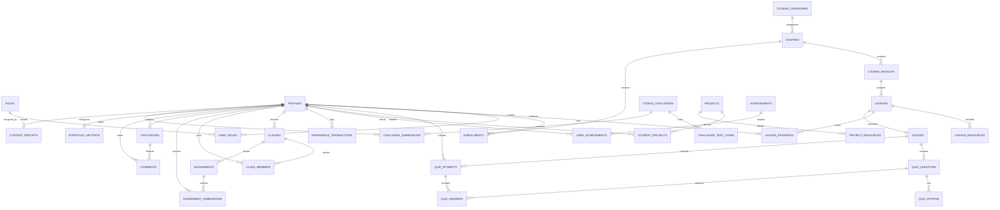

# Sci-Com Academy — Database Schema & Architecture Specification

## 1. Executive Summary & Technology Stack

The **Sci-Com Academy** platform utilizes a normalized, production-grade **PostgreSQL** relational database as its sole and primary data storage system. 

### Key Architectural Standards:
- **Database Engine**: PostgreSQL (Compatible with Supabase, Lovable Cloud, Neon, AWS RDS, and local PostgreSQL instances).
- **Relational Integrity**: Strict enforcement of Primary Keys (PK), Foreign Keys (FK), Check Constraints, and Unique Junction Constraints. No NoSQL or unstructured document stores are used as primary storage.
- **Data Persistence**: Zero reliance on Local Storage or Session Storage for server data. All user profiles, learning progress, course management, quiz attempts, and community interactions are persisted directly to PostgreSQL.
- **Security & Authorization**: Row Level Security (RLS) policies enabled across all 33 tables, combined with database-level Role-Based Access Control (RBAC) preventing unauthorized elevation of roles.
- **Backend Evaluation**: Quiz score calculations and attempt records are processed through a PostgreSQL stored procedure (`public.submit_quiz_attempt`), validating answers against normalized database keys rather than trusting client state.

---

## 2. Entity-Relationship (ER) Diagram



---

## 3. Database Table Catalog (33 Normalized Tables)

### Group A: Users and Authentication

| Table | Primary Key | Foreign Keys | Description |
|---|---|---|---|
| `public.roles` | `id` (UUID) | None | System roles (`admin`, `teacher`, `student`, `guest`). |
| `public.profiles` | `id` (UUID) | `auth.users(id)` ON DELETE CASCADE | Detailed user profile, display name, role, school grade (`ม.4`-`ม.6`), XP, streak, bio. |
| `public.user_roles` | `id` (UUID) | `user_id` -> `profiles(id)`, `role_id` -> `roles(id)` | User role mapping with unique constraint `(user_id, role_id)`. |

### Group B: Courses and Lessons

| Table | Primary Key | Foreign Keys | Description |
|---|---|---|---|
| `public.course_categories` | `id` (TEXT) | None | Subject categories (Web Development, C++, IoT, etc.). |
| `public.courses` | `id` (TEXT) | `category_id` -> `course_categories(id)` ON DELETE SET NULL, `created_by` -> `profiles(id)` | Published, draft, and archived high school IT courses. |
| `public.course_modules` | `id` (TEXT) | `course_id` -> `courses(id)` ON DELETE CASCADE | Curriculum modules within courses with sequential order index. |
| `public.lessons` | `id` (TEXT) | `module_id` -> `course_modules(id)` ON DELETE CASCADE, `course_id` -> `courses(id)` ON DELETE CASCADE | Granular learning lessons (`reading`, `quiz`, `coding`, `interactive`). |
| `public.lesson_resources` | `id` (UUID) | `lesson_id` -> `lessons(id)` ON DELETE CASCADE | Downloadable PDFs, slides, code repositories, diagrams. |
| `public.enrollments` | `id` (UUID) | `user_id` -> `profiles(id)`, `course_id` -> `courses(id)` | Course enrollments. Unique constraint `(user_id, course_id)`. |
| `public.lesson_progress` | `id` (UUID) | `user_id` -> `profiles(id)`, `lesson_id` -> `lessons(id)`, `course_id` -> `courses(id)` | Per-lesson completion status, quiz scores, and time spent. Unique `(user_id, lesson_id)`. |

### Group C: Assessments

| Table | Primary Key | Foreign Keys | Description |
|---|---|---|---|
| `public.quizzes` | `id` (TEXT) | `lesson_id` -> `lessons(id)` ON DELETE CASCADE, `course_id` -> `courses(id)` ON DELETE CASCADE | Assessment definitions, passing scores, and time limits. |
| `public.quiz_questions` | `id` (TEXT) | `quiz_id` -> `quizzes(id)` ON DELETE CASCADE | Assessment questions, question type, points, explanations. |
| `public.quiz_options` | `id` (TEXT) | `question_id` -> `quiz_questions(id)` ON DELETE CASCADE | Normalized options for multiple choice and true/false questions, with `is_correct` boolean. |
| `public.quiz_attempts` | `id` (UUID) | `user_id` -> `profiles(id)`, `quiz_id` -> `quizzes(id)` | Timestamped assessment attempts, total scores, and pass/fail outcome. |
| `public.quiz_answers` | `id` (UUID) | `attempt_id` -> `quiz_attempts(id)`, `question_id` -> `quiz_questions(id)`, `selected_option_id` -> `quiz_options(id)` | Individual answer choices submitted during an attempt, evaluated on backend. |

### Group D: Programming Practice

| Table | Primary Key | Foreign Keys | Description |
|---|---|---|---|
| `public.coding_challenges` | `id` (TEXT) | None | Practice lab coding problems (C++, JavaScript, Python, SQL) with starter code and difficulty. |
| `public.challenge_test_cases` | `id` (UUID) | `challenge_id` -> `coding_challenges(id)` ON DELETE CASCADE | Public and hidden test cases for automated grading. |
| `public.challenge_submissions` | `id` (UUID) | `challenge_id` -> `coding_challenges(id)`, `user_id` -> `profiles(id)` | Student code submissions, execution status, and passed test case counts. |

### Group E: Projects and Portfolio

| Table | Primary Key | Foreign Keys | Description |
|---|---|---|---|
| `public.projects` | `id` (TEXT) | None | Guided laboratory projects (ESP32 IoT, Web Portfolio, etc.) with step-by-step instructions. |
| `public.student_projects` | `id` (TEXT) | `project_id` -> `projects(id)` ON DELETE SET NULL, `user_id` -> `profiles(id)` | Student developed projects, GitHub repositories, demo links, and skills. |
| `public.project_resources` | `id` (UUID) | `project_id` -> `projects(id)` ON DELETE CASCADE | Project starter files, schematics, and libraries. |
| `public.portfolio_settings` | `user_id` (UUID) | `user_id` -> `profiles(id)` ON DELETE CASCADE | Student public portfolio configuration, custom bio, theme, and public visibility toggle. |

### Group F: Gamification

| Table | Primary Key | Foreign Keys | Description |
|---|---|---|---|
| `public.achievements` | `id` (TEXT) | None | Unlockable badges with XP rewards and rarity tiers (`common`, `rare`, `epic`, `legendary`). |
| `public.user_achievements` | `id` (UUID) | `user_id` -> `profiles(id)`, `achievement_id` -> `achievements(id)` | Unlocked badges per student. Unique constraint `(user_id, achievement_id)`. |
| `public.experience_transactions` | `id` (UUID) | `user_id` -> `profiles(id)` ON DELETE CASCADE | Immutable XP ledger tracking every XP awarded with source audit trail. |
| `public.daily_challenges` | `id` (TEXT) | None | Daily rotating challenges for typing, coding, and quiz practice. |

### Group G: Classroom Management

| Table | Primary Key | Foreign Keys | Description |
|---|---|---|---|
| `public.classes` | `id` (UUID) | `teacher_id` -> `profiles(id)` ON DELETE RESTRICT | School classroom sections (e.g., ม.4/1 วิทยาการคำนวณ). Protects teacher deletion while class exists. |
| `public.class_members` | `id` (UUID) | `class_id` -> `classes(id)` ON DELETE CASCADE, `student_id` -> `profiles(id)` ON DELETE CASCADE | Student rosters per classroom. Unique `(class_id, student_id)`. |
| `public.assignments` | `id` (UUID) | `class_id` -> `classes(id)` ON DELETE CASCADE, `created_by` -> `profiles(id)` ON DELETE RESTRICT | Coursework assignments with due dates and rubrics. |
| `public.assignment_submissions` | `id` (UUID) | `assignment_id` -> `assignments(id)` ON DELETE CASCADE, `student_id` -> `profiles(id)` | Student submissions, attachment links, grades, and teacher feedback. |

### Group H: Community

| Table | Primary Key | Foreign Keys | Description |
|---|---|---|---|
| `public.discussions` | `id` (TEXT) | `author_id` -> `profiles(id)` ON DELETE CASCADE | Learning forum discussion threads with likes and status flags. |
| `public.comments` | `id` (TEXT) | `discussion_id` -> `discussions(id)` ON DELETE CASCADE, `author_id` -> `profiles(id)` ON DELETE CASCADE | Replies to forum discussions. |
| `public.content_reports` | `id` (UUID) | `reporter_id` -> `profiles(id)`, `reviewed_by` -> `profiles(id)` | Moderation reports for forum discussions, comments, or student projects. |

---

## 4. Cascading & Deletion Integrity Rules

1. **Course Deletion Cascading (`ON DELETE CASCADE`)**:
   - Deleting a course automatically cleans up its child `course_modules`, `lessons`, `lesson_resources`, `quizzes`, `quiz_questions`, and `quiz_options`.
   - Protects database consistency from dangling references.
2. **Academic Record Protection (`ON DELETE RESTRICT`)**:
   - Deleting a teacher account is blocked (`ON DELETE RESTRICT`) if the teacher owns active `classes` or created `assignments`.
   - Preserves official student grading records and historical auditability.
3. **Soft Preservation (`ON DELETE SET NULL`)**:
   - Deleting a course category or creator profile sets `category_id` or `created_by` to `NULL` while retaining the course content.
   - Student project submissions linked to deleted project templates retain their submission data with `project_id = NULL`.

---

## 5. Security Architecture & Row Level Security (RLS)

All 33 tables have **Row Level Security enabled (`ENABLE ROW LEVEL SECURITY`)**:

| Role | Permissions & Boundaries |
|---|---|
| **Public / Guest** | Can only read published courses (`status = 'published'`), published lessons, public project showcases, active discussions, and public student portfolios (`is_public = true`). Cannot view draft courses, hidden test cases, or private user data. |
| **Student** | Can read all published learning materials. Can create/update **only their own** enrollments, lesson progress, quiz attempts, coding submissions, student projects, assignment submissions, and portfolio settings (`auth.uid() = user_id`). Strictly barred from altering their own `role` in `profiles`. |
| **Teacher** | Can create, edit, publish, and delete courses, modules, lessons, and quizzes. Can manage assigned classes, create assignments, grade student submissions, and view classroom performance analytics. |
| **Administrator** | Full administrative privileges across all tables (`is_admin() = true`). Can manage user roles, review moderation content reports, archive courses, and inspect database audit logs. |

### Trigger-Enforced Role Protection
In addition to RLS, an explicit database trigger `trg_prevent_role_elevation` on `public.profiles` prevents non-administrators from escalating their role from student to teacher or admin:

```sql
CREATE TRIGGER trg_prevent_role_elevation
    BEFORE UPDATE ON public.profiles
    FOR EACH ROW EXECUTE FUNCTION public.check_profile_role_elevation();
```

---

## 6. Stored Procedures & Backend Evaluation

### `public.submit_quiz_attempt(p_quiz_id TEXT, p_answers JSONB, p_user_id UUID)`
Calculates test results strictly on the PostgreSQL server:
1. Queries questions from `quiz_questions` and compares answers against `quiz_options.is_correct`.
2. Computes earned points and percentage score.
3. Inserts an immutable attempt log in `quiz_attempts`.
4. Inserts itemized question answers in `quiz_answers`.
5. Upserts student progress in `lesson_progress`.
6. Generates an XP award transaction in `experience_transactions` and increments `profiles.xp`.
7. Returns a JSON breakdown with question-by-question explanations.

---

## 7. Migration Application Guide

The database migrations are version-controlled in `supabase/migrations/`:

```
supabase/
├── migrations/
│   ├── 20261013000000_scicom_master_schema.sql         # Consolidated all-in-one schema
│   ├── 20261013000001_initial_schema.sql               # 33 Table definitions & PKs
│   ├── 20261013000002_foreign_keys_indexes.sql         # FK constraints & performance indexes
│   ├── 20261013000003_functions_triggers.sql           # RBAC, Quiz RPC & security triggers
│   └── 20261013000004_rls_policies.sql                 # Row Level Security policies
└── seed.sql                                            # Authentic Thai CS curriculum seed data
```

### Applying with Supabase CLI
```bash
supabase db reset
```

### Applying to Existing PostgreSQL / Neon / Lovable
```bash
psql -h <host> -U <user> -d <database> -f supabase/migrations/20261013000000_scicom_master_schema.sql
psql -h <host> -U <user> -d <database> -f supabase/seed.sql
```
